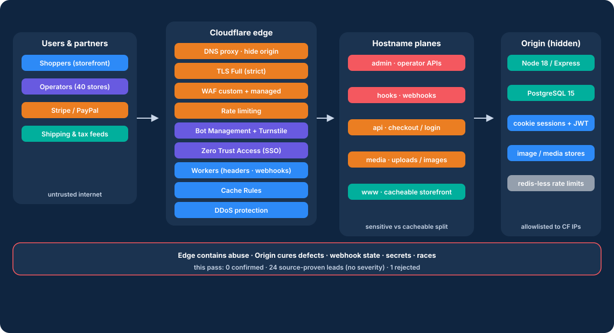
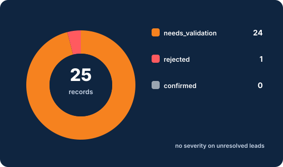
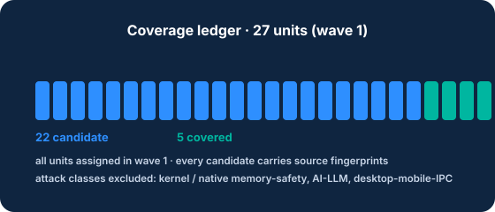

# Harbor & Heath Outdoor Co. — Cloudflare Origin-Readiness POC

<div align="center">

**A source-grounded, machine-checked security audit of a commerce origin headed behind Cloudflare — with the edge controls, week-one plan, and customer briefings to go live safely.**

[](LICENSE)
[](https://github.com/cloudflare/security-audit-skill)
[](https://github.com/cloudflare/security-audit-skill)
[](audit/run-1/REPORT.md) [](audit/run-1/NEEDS-VALIDATION.md) [](audit/run-1/REPORT.md)
[](engagement/08-skill-run-log.md)

[](audit/run-1/architecture.md) [](audit/run-1/architecture.md) [](audit/run-1/architecture.md) [](audit/run-1/architecture.md) [](audit/run-1/architecture.md) [](audit/run-1/architecture.md) [](engagement/05-edge-design.md)

</div>

**Engagement:** pre-production origin security audit · **Audit run:** `harbor-heath-run-1` · **Date:** 2026-09-18
**Target:** Evershop v2.2.1 at commit `18e02022631c1c9dba1b6e5ac734ae27b54632cb` (branch `dev`, clean worktree)

---

## About

Harbor & Heath Outdoor Co. is an EU omnichannel retailer replatforming a monolithic commerce stack onto a self-hosted Node origin, with **go-live behind Cloudflare in ~8 weeks**. This POC ran a full six-phase, source-grounded security audit against the origin twin and produced the answer set security and engineering both need: **what must be fixed in origin, what Cloudflare can enforce in week one, what remains unproven, and what the week-one control plane looks like.**

- **0 confirmed** — no runtime sandbox was available, so the skill forbade any runtime claim (a capability limit, not a clean bill of health).
- **24 needs_validation** — source-proven leads with exact unresolved facts and bounded resolution plans. **No severity is assigned to unproven leads.**
- **1 rejected** — an independent verifier refuted the admin-cookie CSRF claim (browser SameSite=Lax blocks the POST sinks).
- Both schema validators pass: **25 findings / 27 coverage units**. Run is **complete** with a disclosed verification scope.

**Method:** this audit ran Cloudflare's open-source [`security-audit-skill`](https://github.com/cloudflare/security-audit-skill) (MIT, 13k+ stars) in FULL AUDIT MODE — the six-phase pipeline (recon → coverage-led hunting → candidate validation → structured output → independent verification → reporting) whose artifacts and validators you find in `audit/run-1/` and whose customer explanation lives in [`engagement/03-why-this-method.md`](engagement/03-why-this-method.md).

<div align="center">
  
</div>

<div align="center">
  
  
</div>

---

## Executive Summary (for the CISO and the Ecommerce Director)

Harbor & Heath is replatforming onto a self-hosted Node commerce stack with go-live behind Cloudflare in roughly eight weeks. This POC ran a structured, source-grounded security audit of the origin codebase and produced an explicit mapping of what must be fixed in origin, what Cloudflare can enforce in week one, and what remains unproven.

**Verdict counts**

| Verdict | Count | Meaning |
|---|---|---|
| **Confirmed** | 0 | Hidden capability: no finding was *demonstrated at runtime*. This run had no execution sandbox, so nothing is over-claimed. |
| **Needs validation** | 24 | Source-proven defect with an exact unresolved fact that a fixture or a staging check can resolve. **These have no severity.** |
| **Rejected** | 1 | The admin-cookie CSRF lead was disproved by independent verification (browser Lax default blocks the POST sinks) and is retained only so it is not re-raised. |

**What matters most before cutover**

1. **Object-level authorization across the checkout/payment core is missing.** Carts, orders, payment intents, and PayPal order ids are bound by a client-supplied `uuid` with no ownership check, across the public storefront APIs, GraphQL, Stripe, and PayPal endpoints. A 122-bit uuid hides this in practice today, but the control is absent — this is exactly the class Cloudflare rules cannot fix.
2. **A late or non-authoritative Stripe `payment_intent.canceled` can downgrade a settled order** without refund, restock, or events, because the webhook skips the order-state cancelability gate.
3. **Credential endpoints are under-rated.** Public admin/customer JWT-mint endpoints take a ~15× lighter rate-limit tier than real login endpoints, and per-IP buckets are influenceable via client-supplied `X-Forwarded-For` when `TRUST_PROXY_HOPS` is wrong. These are the ones Cloudflare can step in on in week one.
4. **Secrets and defaults need hardening before launch regardless of validation outcome:** the cookie/session secret falls back to the public constant `keyboard cat`, compose publishes PostgreSQL with `postgres/postgres`, and reset tokens ride in email URLs.

**This is a POC, not a clean bill of health.** It proves code-path defects from source and leaves runtime confirmation to you. Resolve the checkout/payment leads (1–4) and the deployment/credentials items before cutover; use the week-one edge plan for the rate-limit and cache surfaces.

**Unproven leads have no severity.** The `needs_validation` rows deliberately carry no CVSS-style scores. They are precise, actionable engineering handoffs, not scanner noise.

---

## What was audited

- **Path:** `/home/illy/workspaces/harbor-heath-origin/evershop` (public architectural twin of the Harbor & Heath commerce origin)
- **Commit:** `18e02022631c1c9dba1b6e5ac734ae27b54632cb`, branch `dev`, worktree clean
- **Scope:** `packages/evershop/src`, `packages/postgres-query-builder`, `packages/create-evershop-app`, `Dockerfile`, `docker-compose.yml`, `docker`, `package.json`, `package-lock.json`
- **Surfaces prioritized:** `/admin` and operator APIs, account/login/password-reset, cart and checkout, payment webhooks (Stripe/PayPal), file/image upload + image pipeline, storefront GraphQL, rate limits, cache/personalized content, secrets in config/CI/Docker/.env examples, cookie/session flags, CORS, TLS-termination assumptions.
- **Excluded (recorded):** kernel/memory-safety of unrelated native runtimes, AI/LLM boundaries (none exist), desktop/mobile/local IPC. Origin source was read-only; no origin code was modified.

---

## How the audit skill was used (plain language)

1. **Recon:** mapped the architecture, trust boundaries, and identity model into `architecture.md` and a 27-unit `coverage-ledger.json`.
2. **Hunting:** nine isolated hunter agents each owned a slice of the ledger and recorded source-traced candidates back into the ledger.
3. **Validation:** every candidate is a source-proven lead. Because this environment has **no OS-enforced sandbox**, no runtime proof was produced — the skill forbids inventing runtime proof, so runtime-dependent leads stay `needs_validation` with the exact unresolved fact.
4. **Independent verification:** six of the highest-value records were given to fresh verifier agents that did not hunt them. Result: 5 kept, and the admin-cookie CSRF lead was **rejected** — an independent verifier proved the browser default SameSite=Lax withholds the cookie on cross-site POSTs. The other 18 retained leads carry exact validation plans.
5. **Reporting:** validators were run against the JSON artifacts (both passed), and this deliverable pack was written from the verified records.

**Key methodological promise:** the agent that found a defect is never the agent that confirms it. Nothing here is presented stronger than the evidence.

---

## The three decisions requested of the customer

1. **Which origin defects must be fixed before cutover?**
   Recommended: the object-level authorization gap in carts/orders/payment intent minting and the Stripe webhook settlement guard (leads 1–4), the JWT-mint rate-tier + XFF trust-proxy accounting (leads 9–10), and the compose DB default credential (lead 22). The first four are origin-only fixes Cloudflare cannot perform.
2. **Which risks can Cloudflare enforce at the edge in week one?**
   Admin-only through Cloudflare Access (protects /admin regardless of the route-level auth detail) and a real POST to /api/paymentIntents behind Turnstile, plus conservative caching for checkout/login, webhook signature verification at the edge (Workers), and WAF/rate-limit on the JWT-mint and password-reset endpoints. See `engagement/04-findings-to-cloudflare.md`.
3. **Which leads are still unproven and must not be described as production vulnerabilities?**
   All 24 `needs_validation` records. The exact unresolved fact and the plan to resolve each is in `audit/run-1/NEEDS-VALIDATION.md`.

---

## Repository map

```
harbor-heath-cf-poc/
├── README.md                        ← this file
├── engagement/                      ← customer-facing deliverables
│   ├── 00-brief.md                  ← engagement brief, scope, success criteria
│   ├── 01-discovery.md              ← discovery questions + assumptions
│   ├── 02-architecture.md           ← current-state origin architecture + proposed future-state
│   ├── 03-why-this-method.md        ← how the audit method works and why
│   ├── 04-findings-to-cloudflare.md ← control mapping table (the operational core)
│   ├── 05-edge-design.md            ← week-one reference architecture
│   ├── 06-week-one-plan.md          ← day-by-day cutover plan
│   ├── 07-talk-track.md             ← 10-minute and 3-minute verbal briefings
│   └── 08-skill-run-log.md          ← what actually ran, validator results, deviations
└── audit/run-1/                     ← the skill's own artifacts (machine + human readable)
    ├── architecture.md              ← source architecture, trust boundaries, rate tiers
    ├── coverage-ledger.json         ← 27-unit coverage ledger with hunter + verifier checks
    ├── findings.json                ← 25 validated records (0 confirmed, 24 needs_validation, 1 rejected)
    ├── REPORT.md                    ← full run profile, leads table, hardening notes
    ├── FINDINGS-DETAIL.md           ← confirmed-finding details (intentionally empty: none confirmed)
    ├── NEEDS-VALIDATION.md          ← per-lead trace, exact blocker, resolution plans
    └── run-metadata.json            ← run metadata + status
```

## Quick start

- **Start with:** `engagement/04-findings-to-cloudflare.md` (the mapping table) and `audit/run-1/REPORT.md` §4 (the leads table).
- **Deep dive:** `audit/run-1/NEEDS-VALIDATION.md` for each lead's exact unresolved fact and how to resolve it.
- **Plan the cutover:** `engagement/05-edge-design.md` + `engagement/06-week-one-plan.md`.
- **Brief stakeholders:** `engagement/07-talk-track.md`. **Audit the method:** `engagement/03-why-this-method.md` + `engagement/08-skill-run-log.md`.

## License

[MIT](LICENSE) © 2026 NullLabTests. The audit artifacts reference the public Evershop project (MIT), which remains the property of its authors; this repository is a standalone deliverable for the fictional Harbor & Heath engagement.